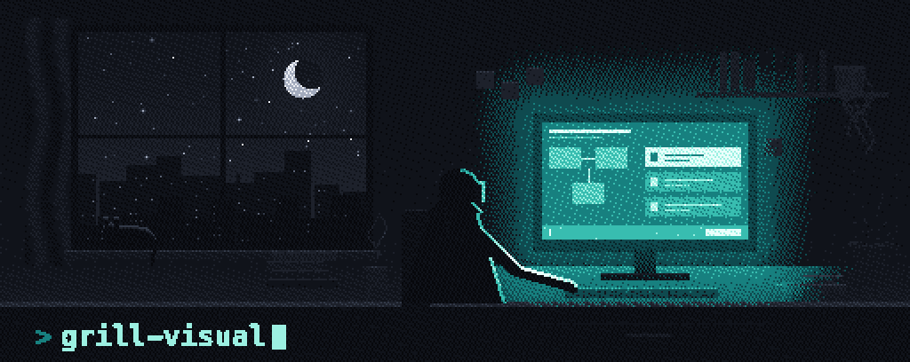
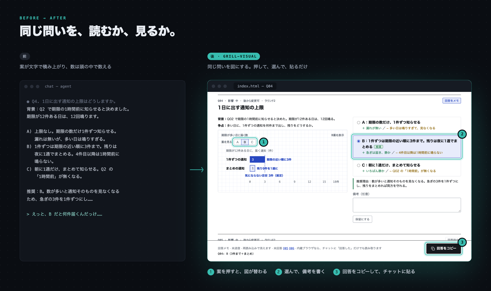
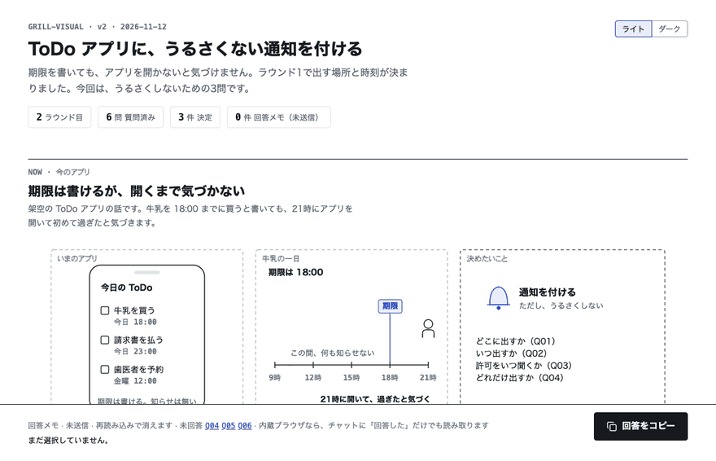

<p align="center"></p>

<p align="center"><b>図を見ながら、AI と計画を詰める。</b><br>
未決の問いを 1 つずつ図にした HTML のページを作ります。図を見て案を選ぶだけで決定がたまり、最後にまとめとタスクの一覧が残ります。</p>

<p align="center">
  <a href="LICENSE"></a>
  
  
</p>

<p align="center">
  <a href="https://sae-eng.github.io/grill-visual/examples/ja/todo-notify/"><b>デモを開く</b></a> &nbsp;·&nbsp;
  <a href="#入れ方">入れ方</a> &nbsp;·&nbsp;
  <a href="#使い方">使い方</a> &nbsp;·&nbsp;
  <a href="#注意">注意</a> &nbsp;·&nbsp;
  <a href="README.md"><b>English</b></a>
</p>

<p align="center"></p>

<p align="center"></p>
<p align="center"><sub>デモは架空の議論「ToDo アプリに通知を付ける」です。</sub></p>

## grill-visual の強み

- 🖼️ **問いごとに図がある。** 情景・画面の再現・グラフ・コマ送りのどれかを、問いごとに描きます。案を押すと図が替わるので、選ぶ前に「何が変わるか」が見えます。
- ⚖️ **決めるための材料が 1 か所にある。** 背景・争点・案ごとの得と損・推奨とその理由を、図の隣に並べます。
- 🔁 **同じページが育つ。** 回答のたびに同じページを更新します。論点の依存マップ、決まった問いの折りたたみ、決定ごとの前 → 後の図が増えていきます。
- ✅ **話し合いで終わらず、作業が残る。** 最後に `summary.html`（完成形の図・決定のカード・経緯）と、依存の順に並んだ `tasks.json` が残り、エージェントがそのまま取りかかれます。
- 🔒 **手元で完結する。** ページは 1 枚の HTML で CDN を読まず、手元の外へは何も送りません。スクリプトが触るのは議論のフォルダだけです。

## できること

| | 内容 |
|---|---|
| **問い** | 安定した ID を付け、影響の大きさと戻しにくさの順に並べる。1 ラウンド 6 問（最大 8 問）。前提の決まっていない問いは後に回す。`q=N`・`r=N` で上限も付けられる |
| **図** | 情景・画面の再現・たとえ。数から描くグラフ（`.json`）、線画の部品（`.js`）、案ごとの層、▶ で進むコマ送り |
| **回答** | 問いごとに選択・保留・備考。「回答をコピー」は clipboard API が無い所でも 1 回で写せる。チャットに `Q01: A` と書いてもよい |
| **議論のページ** | 決定・今回・後での状態が見える依存マップ。決まった問いと見送った問いは折りたたむ。ライトとダーク |
| **まとめ** | 完成形の図、仕組みの図、前 → 後つきの決定のカード、進み具合と依存の図つきのタスクの章、ラウンドの経緯 |
| **タスク** | `tasks.json` は `task.mjs` がロックを取って書く（`doing`・`step`・`done`・`blocked`）。タスクごとに証拠と確かめた結果を残す。開いたままのまとめが数秒ごとに進み具合を読み直す |
| **検査** | `verify.mjs` が、すべての案・すべてのコマ・ダークで、11px 未満の文字、重なり、はみ出し、図の色が 4 色を超えること、描いた幅より大きく広がった図を調べる。回答欄とコピーのボタンも 1 回押して確かめる |
| **記録** | `discussion.md` に、問い・回答・理由・前提・見直す条件を残す |

## 入れ方

```bash
npx skills add https://github.com/Sae-Eng/grill-visual/tree/main/skills/ja/grill-visual
```

版を固定するときは、タグを指定します。

```bash
npx skills add https://github.com/Sae-Eng/grill-visual/tree/v0.1.0/skills/ja/grill-visual
```

英語版は `skills/en/grill-visual` です。Claude Code・Codex・Cursor など、Agent Skills を読むエージェントで動きます。

## 使い方

```text
/grill-visual この計画の未決事項を、図を見ながら詰めたい
```

1. エージェントが計画や資料を読み、決めることを論点に分けて、議論のページ（`index.html`）を開きます。
2. 問いごとに図があり、案のボタンを押すと図が替わります。案を選び、備考を書きます。
3. 画面の下の「回答をコピー」を押して、チャットに貼ります。
4. エージェントが答えを受けて、同じページに決定の前と後の図を足し、次の問いを出します。
5. 決まったら、決定とタスクのまとめ（`summary.html`）と `tasks.json` ができます。

## 要るもの

- Node.js 22 以上（組み立てと確かめのスクリプト）
- 確かめ（`verify.mjs`）には Chrome か Chromium。無ければ確かめを飛ばし、「見た目は確かめていない」と伝えて進みます。

## 注意

このスキルは、手元で次のスクリプトを動かします。

| スクリプト | すること | 読み書きする物 |
|---|---|---|
| `scripts/build.mjs` | page.json と図の断片からページを組み立てる | 議論のフォルダの中だけ |
| `scripts/verify.mjs` | ヘッドレスの Chromium でページを開いて測る | 一時フォルダのプロファイルとスクショ |
| `scripts/task.mjs` | tasks.json のタスクの状態を書き戻す | 議論のフォルダの `tasks.json` |

- 図の断片（`fig/*.js`）は `node:vm` で動かします。`node:vm` は安全のための隔離ではありません。自分か自分のエージェントが書いた図だけを組み立ててください。
- `verify.mjs` は、使い捨てのプロファイルと `--allow-file-access-from-files` で Chromium を開きます。普段のブラウザのプロファイルには触れません。
- スクリプトは手元の外へ通信しません。`verify.mjs` が話すのは、自分で起動した Chromium とのローカルな DevTools の接続だけです。できるページは1枚で完結し、外の CDN を読みません。
- 議論のページは既定で `artifacts/grill-visual/<題>/` にできます。リポジトリに残したくなければ `.gitignore` に入れてください。

## 提案と報告

- 提案や不具合は Issue で受けます。PR は受けていません（[CONTRIBUTING](CONTRIBUTING.md)）。
- セキュリティの問題は、公開の Issue ではなく [SECURITY](SECURITY.md) の方法で知らせてください。

## ライセンス

MIT。Inspired by [grill-me](https://github.com/mattpocock/skills)（Matt Pocock）。
