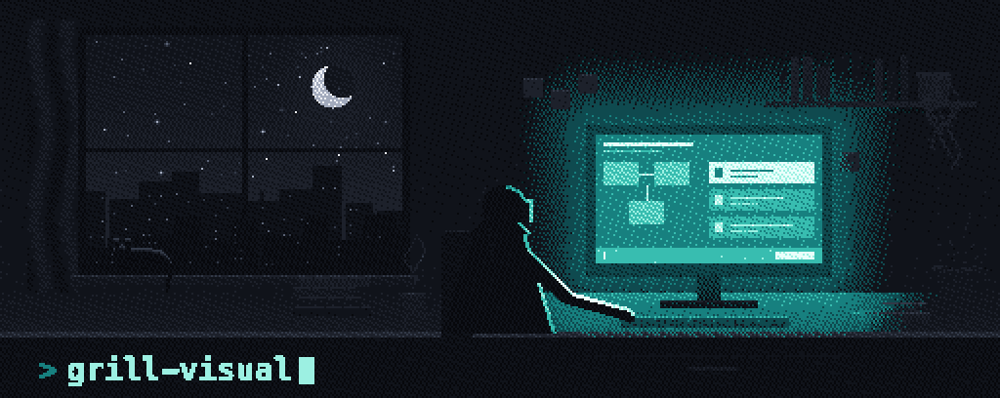
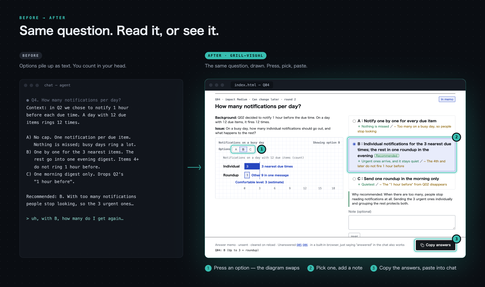
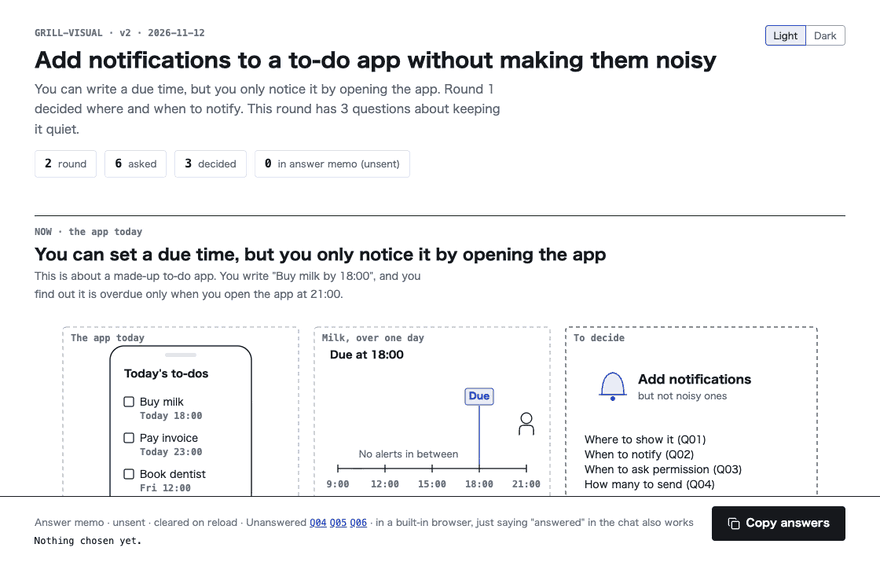

<p align="center"></p>

<p align="center"><b>Settle a plan with your AI by looking at pictures.</b><br>
Each open question becomes a diagram on an HTML page. You look, pick, and the decisions pile up into a summary and a task list.</p>

<p align="center">
  <a href="LICENSE"></a>
  
  
</p>

<p align="center">
  <a href="https://sae-eng.github.io/grill-visual/examples/en/todo-notify/"><b>Live demo</b></a> &nbsp;·&nbsp;
  <a href="#install">Install</a> &nbsp;·&nbsp;
  <a href="#use">Use</a> &nbsp;·&nbsp;
  <a href="#caution">Caution</a> &nbsp;·&nbsp;
  <a href="README.ja.md"><b>日本語</b></a>
</p>

<p align="center"></p>

<p align="center"></p>
<p align="center"><sub>The demo is a made-up discussion: "add notifications to a to-do app".</sub></p>

## Why grill-visual

- 🖼️ **A diagram for every question.** Each question comes with a scene, a UI mock-up, a chart or a step player. Pressing an option swaps the diagram, so you see what a choice changes before you pick it.
- ⚖️ **Everything you need to decide, in one place.** Background, the issue, options with their trade-offs and a recommendation with its reason sit next to the diagram.
- 🔁 **One page that keeps up.** The same page updates after every round: a dependency map of the questions, decided ones folded away, and a before → after diagram for each decision.
- ✅ **Ends in work, not just talk.** You finish with `summary.html` (the final picture, decision cards, history) and `tasks.json`, a dependency-ordered task list your agents can pick up.
- 🔒 **Local and self-contained.** Each page is one HTML file that loads nothing from a CDN, and nothing leaves your machine. The scripts only touch the discussion folder.

## Features

| | What you get |
|---|---|
| **Questions** | Stable IDs, ordered by impact and how hard they are to undo. Six per round by default (eight at most). A question that depends on another waits for it. Optional limits `q=N` and `r=N`. |
| **Diagrams** | Scenes, UI mock-ups and analogies; charts drawn from numbers (`.json`); a parts library for line drawings (`.js`); one layer per option; a step player with ▶. |
| **Answering** | Choices, Hold and a note per question. "Copy answers" works with one press, even where the clipboard API is missing. You can also type `Q01: A` in the chat. |
| **Discussion page** | A dependency map that shows what is decided, current or later. Decided and skipped questions fold away. Light and dark themes. |
| **Summary** | The final picture, mechanism diagrams, decision cards with before → after, a task chapter with progress and a dependency graph, and the history of rounds. |
| **Tasks** | `tasks.json` updated through `task.mjs` with a lock (`doing`, `step`, `done`, `blocked`). Each task keeps its proof and how it was checked. The open summary picks up progress every few seconds. |
| **Checks** | `verify.mjs` checks every option, every frame and dark mode for text under 11px, overlaps, overflow, more than four colors in a diagram, and diagrams stretched beyond their drawn width. It also presses the answer fields and the copy button once. |
| **Record** | `discussion.md` keeps each question, the answer, the reason, assumptions and when to revisit. |

## Install

```bash
npx skills add https://github.com/Sae-Eng/grill-visual/tree/main/skills/en/grill-visual
```

To pin a version, name a tag.

```bash
npx skills add https://github.com/Sae-Eng/grill-visual/tree/v0.1.0/skills/en/grill-visual
```

The Japanese version lives in `skills/ja/grill-visual`. It works with agents that read Agent Skills, such as Claude Code, Codex and Cursor.

## Use

```text
/grill-visual Help me settle the open questions in this plan, with diagrams
```

1. The agent reads your plan, splits what needs deciding into questions, and opens a discussion page (`index.html`).
2. Every question has a diagram. Pressing an option's button swaps the diagram. Pick an option and add a note.
3. Press "Copy answers" at the bottom and paste into the chat.
4. The agent records the answers, adds before/after diagrams of each decision to the same page, and asks the next questions.
5. When everything is decided, you get a summary of decisions and tasks (`summary.html`) and a `tasks.json`.

## Requirements

- Node.js 22 or later (for the build and check scripts)
- Chrome or Chromium for the check (`verify.mjs`). Without it the check is skipped and the agent says the look was not checked.

## Caution

The skill runs these scripts on your machine.

| Script | What it does | What it reads and writes |
|---|---|---|
| `scripts/build.mjs` | Builds the pages from page.json and diagram fragments | Only the discussion folder |
| `scripts/verify.mjs` | Opens the page in headless Chromium and measures it | A temporary profile and a screenshot in the temp folder |
| `scripts/task.mjs` | Writes task states back | `tasks.json` in the discussion folder |

- Diagram fragments (`fig/*.js`) run in `node:vm`. `node:vm` is not a security boundary. Only build diagrams written by you or your own agent.
- `verify.mjs` starts Chromium with a throwaway profile and `--allow-file-access-from-files`. It never touches your everyday browser profile.
- The scripts send nothing outside your machine. `verify.mjs` only talks to the Chromium it starts, over a local DevTools connection. Each page is a single self-contained file and loads nothing from a CDN.
- Pages go to `artifacts/grill-visual/<topic>/` by default. Add that folder to `.gitignore` if you don't want it in your repository.

## Feedback

- Suggestions and bugs go to Issues. Pull requests are not accepted ([CONTRIBUTING](CONTRIBUTING.md)).
- Report security problems privately as described in [SECURITY](SECURITY.md), not in a public issue.

## License

MIT. Inspired by [grill-me](https://github.com/mattpocock/skills) (Matt Pocock).
